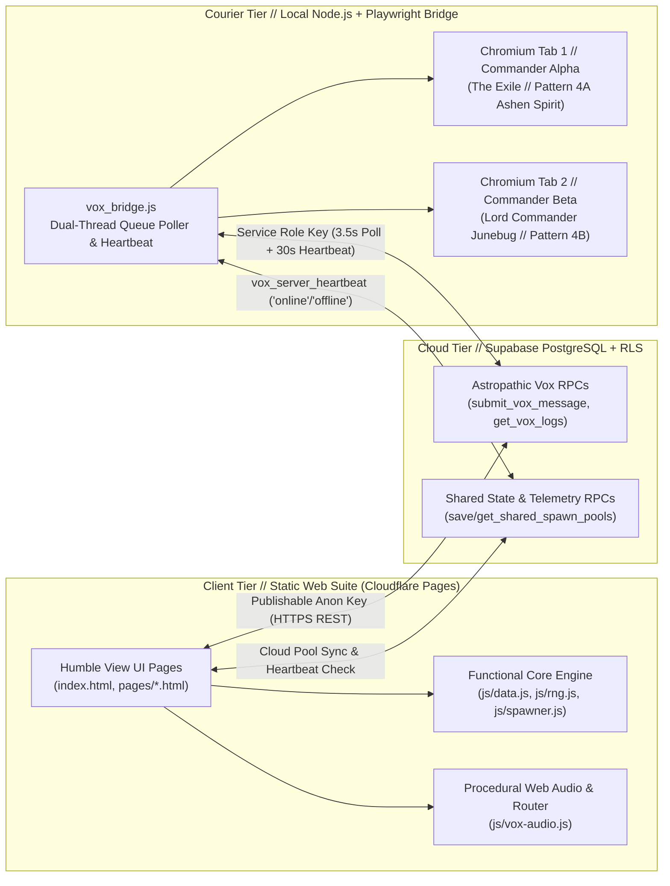

# Fires of Armageddon // Warhammer 40,000 Horde & Asymmetric Crusade Suite

A zero-dependency, offline-tolerant web companion suite, deterministic wave spawner, and real-time AI-bridged Astropathic Vox relay designed for cooperative, solo, and asymmetric Warhammer 40,000 Crusade campaigns.

---

## 🗺️ System Architecture

The project is engineered as a **three-tier hybrid architecture** combining a static client-side tactical suite (hosted on Cloudflare Pages), a serverless PostgreSQL/RPC state & message relay layer (Supabase), and a local dual-thread Playwright automation courier (`vox_bridge.js`) that bridges live Google Gemini web sessions into an in-universe Campaign Master.



---

## 🤖 AI Involvement & Human-AI Collaboration

This project integrates Artificial Intelligence across **two distinct layers**: as a **live runtime component** during tabletop campaign sessions, and as an **agentic pair-programming partner** during software engineering.

### 1. Runtime AI Involvement (Live Campaign Master & Asymmetric Narrative Engine)
During live campaign play, AI acts as the autonomous **Campaign Master**, **3rd Alliance ("The Marauders") Scavenger Commander**, and **Flagship Logic Core**:
- **Dual-Thread Google Gemini Automation (`vox_bridge.js`)**: Rather than calling stateless completion APIs, `vox_bridge.js` uses Playwright with an isolated persistent Chromium profile (`./chrome_vox_profile`, strictly separated from Tactica's `./chrome_tactica_profile` so both terminals can run simultaneously) to drive long-running, context-rich Google Gemini notebook/chat threads—isolated across **Commander Alpha (`THE EXILE // SANCTUARY OF ASH`)**, **Commander Beta (`LORD COMMANDER JUNEBUG`)**, and **Commander Gamma (`FANE-NODE VÔL-09`)**.
- **Dynamic Prompt Routing & Pattern Injection**: When a player transmits a report from any page (`crusade.html`, `pvp.html`, `rogue.html`, `roster.html`, or `vox.html`), `vox_bridge.js` inspects the teletype header and wraps it in specialized system directives:
  - **Pattern 4A / 4B Ship Queries (`isShipQuery`)**: Routes `[TO: SHIP]` queries to either the *Pattern 4A Ashen Spirit cogitator readout* (`alpha` channel) or the *Pattern 4B Flagship Bridge Logic Core readout* (`beta` channel), preventing cross-flagship lore contamination.
  - **Pattern 5 Psychic Intercept Bleed**: Instructs the AI to append a `+++ [PASSIVE ASTROPATHIC CHOIR INTERCEPT] +++` block at the end of its response. `vox_bridge.js` programmatically splits this block out of the direct reply, scrubs citation artifacts, and injects it into the **rival commander's** `[ 👁️ INTERFERENCES ]` monitor (or broadcasts to **both** channels simultaneously for Mode 3 Rogue Sector clashes).
- **NotebookLM & Gemini Context Ingestion (`/bundles/`)**: The build script [`scripts/generate_bundles.js`](scripts/generate_bundles.js) compiles the entire repository into 12 domain-scoped Markdown bundles in [`/bundles/`](bundles/README.md) so the AI Campaign Master notebooks remain synchronized with live game rules, threat brackets, and Nemesis rosters.

### 2. Development-Time AI Involvement (Human-Directed Agentic Engineering)
- **Human Direction, Game Design & Architecture**: The tabletop game mechanics, asymmetric 3-Way Alliance Hegemony race, Tour of Duty progression, Warhammer 40k Crusade adaptations, UI/UX layout, and architectural constraints were designed and directed by the project creator.
- **Agentic Pair Programming (Google Antigravity)**: Code implementation, refactoring, procedural Web Audio synthesis, SVG sector cartography, Playwright DOM-stream stabilization, and the automated test suite were co-developed with **Google Antigravity** (utilizing Claude and Gemini coding models) under the strict engineering constitution codified in [`AGENTS.md`](AGENTS.md):
  - **100% Test-Driven Development (TDD)**: Every feature, bug fix, and UI boundary is backed by automated Node.js unit and headless Playwright browser tests (`362` passing tests across `tests/js/`, `tests/ui/`, `tests/tactica_daemon.test.js`, and `tests/vox_bridge.test.js`) written via Red-Green-Refactor cycles.
  - **Continuous Bundle Synchronization**: Autonomous agents are strictly bound by `AGENTS.md` Principle IX to regenerate and verify `/bundles/*.md` on every file modification.

---

## 🏛️ Clean Code Architecture & Pattern

Per [`AGENTS.md`](AGENTS.md), the codebase enforces strict modularization and the **Functional Core, Imperative Shell** ("Dumb UI" / Humble View) pattern:

1. **Functional Core (Pure Domain Logic)**:
   - All game rules, Strategic Point calculations, PRNG algorithms, heartbeat staleness evaluators, ViewModel selectors, and teletype dossier compilers (`CrusadeCore` in `js/crusade-core.js`, `compileRogueDossier`, `compilePvpVultureReport`, `compileNemesisDossier`, `isVoxServerOnline`, `mulberry32`, `resolveThreatBracket`, `executeRoundSpawns`) are written as pure, deterministic functions `(state, input) => output` with zero dependency on `document`, `window`, `localStorage`, or `fetch`.
2. **Declarative Rule Lookup Tables**:
   - Game outcomes (`ROGUE_OUTCOME_IMPACTS`), Crusade channel & tab descriptors (`DOSSIER_CHANNEL_PROFILES`, `CRUSADE_TAB_DESCRIPTORS`, `LEFTOVER_SP_SALVAGE_TIERS`), faction spawn brackets (`HORDE_FACTION_SPAWN_TABLES`), room-code prefixes (`ROOM_CODE_PREFIXES`), and environmental tables (`HELLSCAPES`, `ANOMALIES`) are modeled as declarative data maps rather than deeply nested `if / else` branching chains.
3. **View Imperative Shell**:
   - DOM interaction is isolated to thin input readers (`readRogueFormInputs`, `readPvpVultureFormInputs`, `readNemesisFormInputs`) and idempotent UI renderers (`renderServerStatusIndicator`, `updateRogueDossierPreview`, `renderFactionBracketTable`) that project explicit state onto the DOM and forward user events back to the pure core.

---

## 🔬 Technical Deep-Dive by Subsystem

### 1. Deterministic PRNG & Seeded Horde Spawner (`js/rng.js`, `js/spawner.js`, `js/data.js`)
- **Cross-Tabletop Seed Synchronization**: Co-op players enter a shared room seed (generated from 60 thematic Warhammer 40k prefixes such as `GOLGOTHA-4821` or `ASHEN-9012`). [`hashSeed()`](js/rng.js) hashes the string via a 32-bit avalanche mixer to seed [`mulberry32()`](js/rng.js), ensuring two separate tablets roll identical enemy spawns, misery cards, and resupply drops without requiring a live WebSocket connection during tabletop play.
- **Wave Escalation, TTS Wave Parser & Pity-Timer Math**: [`spawner.js`](js/spawner.js) computes per-round 2D6 modifiers based on Battle Round ($R_1 \dots R_5$), player count, and difficulty mode, resolving rolls against 5 threat brackets (`b34`, `b56`, `b79`, `b10`, `b13`), parsing `<Count> <Exact Name TTS Template>` wave specs via [`parseSpawnWaveSpec()`](js/spawner.js) (supporting `,` choices, `+` combo waves, dice prefixes like `1D3` / `D3+1`, and `[Embarked]` transport passengers), and dynamically scaling Resupply Pod drop probabilities via a cumulative pity counter.

### 2. Procedural Web Audio Synthesizer & Seamless Router (`js/vox-audio.js`)
- **Zero-Asset Web Audio API Synthesis**: Instead of loading external `.mp3` or `.wav` files, `VoxAudio` synthesizes all tactile UI feedback in real time using native `AudioContext` oscillator, gain, noise-buffer, and biquad-filter graphs:
  - Mechanical cogitator key-clanks (`playClank`), CRT teletype bursts, tiered Unbound Adversary Warp-Breach alerts (`playUnboundBreachAlert` filtered triangle/sine perimeter lock for Bracket `[10–12]` vs full sub-bass Geller-field failure `playWarpSiren` reserved for Bracket `[13+]` and PL 4 Apex Anomalies), orbital auspex locks (`playAuspexLock`), and a continuous sub-bass shipboard ambient drone.
- **Seamless SPA-Style Page Router**: To prevent the browser from destroying the active `AudioContext` ambient drone when navigating between `.html` pages, `vox-audio.js` intercepts internal navigation clicks, fetches the target HTML document in the background, swaps the `.shell` / `<main>` DOM tree, and safely re-evaluates page scripts in a clean lifecycle.

### 3. Supabase RPC Backend, Cloud Pool Sync & Live Server Telemetry
- **RLS & `SECURITY DEFINER` Isolation**: The browser client uses a publishable anon key restricted solely to vetted PostgreSQL RPC endpoints (`submit_vox_message`, `get_vox_logs`, `delete_vox_entry`, `save_shared_spawn_pools`, `get_shared_spawn_pools`). Direct table mutations require the `SUPABASE_SERVICE_KEY` held exclusively by the local `vox_bridge.js` courier.
- **Cross-Device Custom Shelf Barracks (`pages/roster.html`, `pages/spawner.html`)**: Players configure per-faction miniature pools in `roster.html` and sync them to Supabase via `save_shared_spawn_pools`. Pools are strictly isolated under `byFaction` (`foa_custom_shelf_pool_v1`) with zero hardcoded default fallbacks, ensuring Mode 1 Spawner and Mode 4 TTS preparation checklists reflect only configured units.
- **Live Courier Server Heartbeat (`vox_server_heartbeat`)**: `vox_bridge.js` publishes `{ status: 'online', updated_at }` to the shared state row on startup and every 30 seconds (and `{ status: 'offline' }` on `SIGINT`/`SIGTERM`). [`pages/vox.html`](pages/vox.html) polls this metadata and uses the pure [`isVoxServerOnline()`](pages/vox.html) evaluator (with a 90-second staleness window) to render a live green/red status badge on both the Security Clearance screen and the active CRT terminal header.

### 4. Astropathic Courier Playwright Engine (`vox_bridge.js`)
- **Concurrent Dual-Tab State Machine**: Manages two persistent Chromium pages in parallel locks (`isProcessing.alpha`, `isProcessing.beta`), draining pending Supabase queue items in FIFO order.
- **Streaming Stability & Artifact Scrubbing**: Polls the Gemini DOM response container until character length stabilizes across `STABLE_CHECKS_REQUIRED` consecutive intervals and all generating indicators disappear. [`scrubArtifacts()`](vox_bridge.js) and [`extractCleanLastModelResponse()`](vox_bridge.js) strip NotebookLM source citation chips, unwrap markdown code fences, sanitize nested HTML `<p>` tags inside `<li>` elements, and partition direct replies from cross-channel psychic intercepts.

### 5. In-Match LCT Tactical Console, Horde Autopilot, Live Overwatch & Persistent Scribe (`pages/tactica.html`, `js/tactica-core.js`, `js/tts-telemetry-core.js`, `js/horde-autopilot-core.js`, `js/tactica-overwatch-core.js`, `js/tactica-overwatch.js`, `js/tactica.js`, `tactica_daemon.js`, `tts/lct_horde_bridge.lua`)
- **Non-Invasive LCT Orbital Auspex Beacon (`tts/lct_horde_bridge.lua`)**: Attaches to a single Token/Checker placed on the edge of Lasombra's Competitive Table (leaving LCT's Global Lua chess clocks, scoreboards, terrain layouts, and mat scripts 100% untouched), forcing itself upright on load (`setRotation`), providing elevated 3D buttons plus backup Right-Click Context Menu actions (including `HORDE_TEMPLATE` shelf tagging), auto-detecting LCT's central `44"x60"` / `60"x44"` playmat bounds (`detectPlaymatBounds`), scanning on-mat miniatures/objectives into `/tts/telemetry` while ignoring LCT cameras/Objective Secured chips, applying browser-driven `SET_UNIT_SIDE` tag flips, cloning off-board `HORDE_TEMPLATE` models into Spawn Zones (`SPAWN_WAVE`), reverting LOS-blocked moves (`REVERT_MOVE`), and orchestrating physical dice rolls inside LCT's Red/Blue dice mats.
- **Deterministic Horde Autopilot Core (`js/horde-autopilot-core.js`)**: Pure functional core with zero local RNG computing `SPAWN_WAVE` commands from synced Mode 1 `zoneSpawns`, obstacle-aware Movement/Advance vectors with `SPAWN_GHOST_RING` waypoints and exact `(x, y, z)` pre-Overwatch LOS revert snapshots, Mode 3 keyword-driven shooting target priority (`[ANTI-X]`, `[PRECISION]`, `[MELTA]`) respecting 11th Edition Hidden (`15"`) / Gone to Ground (`12"`) visibility caps, `2D6` LCT mat Charge rolls, and 3-tier Consolidation (`ONGOING` -> `ENGAGING` -> `OBJECTIVE` -> `HOLD`).
- **Live Screen & Microphone Overwatch Referee & Crusade Handoff (`js/tactica-overwatch-core.js`, `js/tactica-overwatch.js`)**: Captures on-demand JPEG frames from the shared TTS window (`getDisplayMedia`) alongside push-to-talk Web Speech commands, verifies 3D ruin Line-of-Sight via `POST /overwatch/los-check` (auto-enqueuing `REVERT_MOVE` and filtering `losBlockedPairs`), announces Player reaction windows, surfaces 6+ Big-Bracket Warp-Breach Intrusion Vox alerts, and exports post-match telemetry directly to Mode 5 Crusade (`foa_horde_battle_stats_v1`).
- **Pure TTS Telemetry, Prop Filter & Deployed Army Classifier (`js/tts-telemetry-core.js`)**: Strips TTS BBCode/color tags while preserving `[LETHAL HITS]` weapon brackets, rejects off-mat reserves (`playmatBounds`), locked terrain, cameras, Objective Secured chips (`PROP_NAME_BLACKLIST`), and non-datasheet props (`hasDatasheetSignature`), extracts Yellowscribe/ForceOrg stats, saves, FNP, Scouts, and weapon profiles, auto-classifies pre-deployed untagged armies as `PLAYER` vs `HORDE` against `hordeFactionName` (`HORDE_FACTION_ALIASES`, `inferSide`), computes exact 2D base-edge-to-base-edge distances in inches, and supports 1-click `[⇄ Flip Side]` (`toggleTelemetryUnitSide` -> `POST /tts/set-side`) alongside Auto-Defender form population in [`pages/tactica.html`](pages/tactica.html).
- **100% LCT TTS Dice-Mat Orchestration (Zero Local RNG)**: [`js/tactica-core.js`](js/tactica-core.js) implements deterministic multi-stage state machines for Horde Auto-Defender (`SAVES` -> `FNP` -> `ON_DEATH` -> `GSC_RESPAWN`) and Horde Attacks (`TAU_GLASSES` -> `HITS` -> `HIT_REROLLS` -> `WOUNDS` -> `WOUND_REROLLS`), advancing strictly from settled pip arrays rolled on the LCT (11th Ed FTC) Tabletop Simulator dice mat or entered offline.
- **Local HTTP Relay, Isolated Referee Browser & Crash-Proof Disk Scribe (`tactica_daemon.js`)**: Zero-dependency `127.0.0.1:3030` daemon queuing `LCT_MAT_ROLL` and `SET_UNIT_SIDE` commands on `GET /tts/poll`, receiving settled pips on `POST /tts/dice-result`, passing `liveState.factionName` into `normalizeTtsBoardScan` on `POST /tts/telemetry`, driving `TACTICA_THREAD_URL` in its own dedicated `./chrome_tactica_profile` Chromium instance (never colliding with `./chrome_vox_profile`), auto-locking the first spawned Horde `CHARACTER` as Warlord, and persisting `live_state.json` + `match_chronicle.jsonl` in `match_logs/` so Round 1–6 logs survive restarts and compile cleanly for optional Astropathic Vox archival.

---

## Suite Modules (`index.html` & `pages/*.html`)

| Module | File | Core Technical Capabilities |
| :--- | :--- | :--- |
| **📖 Field Codex Launchpad** | [`index.html`](index.html) | Central command hub, onboarding protocol, and unified navigation bar. |
| **🧟 Mode 1: Horde Spawner** | [`pages/spawner.html`](pages/spawner.html) | Seed-synchronized wave generator, Misery Card deck manager, Pity-Timer resupply engine, and Cloud Pool integration. |
| **🖥️ In-Match Tactical Console** | [`pages/tactica.html`](pages/tactica.html) | Live Mode 1 session sync, Player Stratagem reaction windows, LCT TTS dice-mat Auto-Defender queue, persistent Round 1–6 chronicle scribe, and post-match Vox compiler. |
| **⚔️ Mode 2: 1v1 Ash Wastes PvP** | [`pages/pvp.html`](pages/pvp.html) | Dynamic Hellscape selector, Warp Intensity anomaly roller, Unbound Adversary spawner, and 3rd Alliance Vulture SPts Match Report compiler (`compilePvpVultureReport`). |
| **🎲 Mode 3: Rogue Sector & AI** | [`pages/rogue.html`](pages/rogue.html) | 3-Step autonomous AI behavioral state machine and declarative Rogue Sector Battle Report compiler (`ROGUE_OUTCOME_IMPACTS`, `compileRogueDossier`). |
| **🎖️ Mode 4: Hostile Matrix** | [`pages/roster.html`](pages/roster.html) | Cross-Mode Nemesis Bounty Ledger, Ordo Malleus Nemesis Induction compiler (`compileNemesisDossier`), Unbound Datasheets, and Supabase-synced Shelf Barracks. |
| **🏆 Mode 5: Crusade Command** | [`pages/crusade.html`](pages/crusade.html) | MVVM Humble View backed by pure [`js/crusade-core.js`](js/crusade-core.js): 3-Way Alliance Scoreboard, branching narrative trees, RNG-injectable D6 upgrade rollers, Astra Militarum Logistics, Necron Tomb World Matrix, Leagues of Votann Expeditions, and DOM-free Master Post-Battle Dossier compilers. |
| **📜 Mode 6: Briefings & Atlas** | [`pages/briefing.html`](pages/briefing.html) | Passcode-sealed Commander Alpha/Beta dossiers, interactive `SHIP.md` orbital slider, 8-node interactive SVG Sector Atlas, and 3-Way Parallel Hegemony Race bars. |
| **📡 Mode 7: Astropath Vox** | [`pages/vox.html`](pages/vox.html) | Pass-Seal authenticated CRT terminal, elapsed-time teletype text streamer, Direct vs. Interferences monitors, `[ ✕ PURGE ]` RPC controls, and live Courier Server Status indicator. |
| **🎓 Quickstart Tutorials** | [`pages/welcome.html`](pages/welcome.html) | Field operations manual and guided walkthrough for all 7 suite modes. |

---

## 📂 Repository Structure

```text
armageddon-vox/
├── index.html                  # Root entry point (Field Codex & Command Launchpad)
├── AGENTS.md                   # Non-negotiable engineering & architectural directives
├── README.md                   # Technical architecture & project documentation
├── vox_bridge.js               # Dual-thread Playwright courier bridging Supabase <-> Gemini
├── tactica_daemon.js           # Local 127.0.0.1:3030 LCT TTS dice-mat queue & JSONL chronicle scribe
├── vox_autopilot.bat           # Windows launcher for Astropathic Courier (chrome_vox_profile)
├── tactica_daemon.bat          # Windows launcher for LCT Tactical Daemon (chrome_tactica_profile)
├── package.json                # Scripts & dev/runtime dependencies (Playwright, dotenv)
├── wrangler.jsonc              # Cloudflare Pages static deployment configuration
├── assets/                     # Vector icons & favicons (favicon.svg, favicon.png)
├── css/
│   └── style.css               # "Sanctuary-Noctis Hybrid" tactical stylesheet & CRT tokens
├── js/
│   ├── data.js                     # Faction tables, missions, misery cards, and lore constants
│   ├── rng.js                      # Deterministic hashSeed(), mulberry32() PRNG & 60 room prefixes
│   ├── spawner.js                  # Pure wave-spawning math, TTS wave parser & bracket resolution
│   ├── horde-combat-modifiers.js   # Pure 23-faction rules, 36 Misery mods & Auto-Defender core
│   ├── tts-telemetry-core.js       # Pure TTS BBCode stripper, Yellowscribe parser & 2D geometry
│   ├── horde-autopilot-core.js     # Pure Horde wave spawning, LOS-revert moves, target priority & consolidation
│   ├── tactica-overwatch-core.js   # Pure voice intent parser, 3D LOS prompt/verdict, 6+ alerts & Crusade handoff
│   ├── tactica-overwatch.js        # Browser getDisplayMedia frame capture, push-to-talk mic & Crusade exporter
│   ├── tactica-core.js             # Pure LCT dice-mat state machines, reaction windows & R1-R6 compiler
│   ├── tactica.js                  # In-Match Tactical Console imperative controller & offline mat bridge
│   ├── crusade-data.js             # 11th Ed Crusade upgrade vaults, faction tables & narrative trees
│   ├── crusade-core.js             # Pure Crusade Functional Core, ViewModel selectors & dossier compilers
│   ├── crusade-forge.js            # Crusade Humble View shell for Scoreboard, Forge & Tour of Duty
│   ├── crusade.js                  # Crusade Humble View shell for Tomb Matrix, Votann & Master Dossier
│   ├── horde-battle-stats.js       # Horde combat telemetry tracker & Crusade dossier compiler
│   ├── app.js                      # Mode 1 Horde Command UI controller & localStorage state
│   └── vox-audio.js                # Procedural Web Audio synth & seamless SPA page router
├── tts/
│   └── lct_horde_bridge.lua    # Non-invasive LCT Beacon token Lua script (preserves LCT Global)
├── pages/                      # Modular suite views (spawner, tactica, pvp, rogue, roster, crusade, briefing, vox, welcome)
├── scripts/
│   └── generate_bundles.js     # Automated compiler for /bundles/*.md AI context artifacts
├── bundles/                    # Modular Markdown codebase bundles for Gemini / NotebookLM
└── tests/                      # 365 automated tests (Node:test + VM sandboxes + Playwright)
    ├── vox_bridge.test.js      # Courier prompt routing, scrubbing, queue & heartbeat tests
    ├── tactica_daemon.test.js  # LCT dice-mat polling, multi-stage sequence & JSONL restart tests
    ├── js/                     # Unit tests mirroring js/*.js
    └── ui/                     # Boundary, DOM, and headless browser E2E integration tests
```

---

## 🧪 Testing & Verification

The repository maintains a strict **100% test pass target** (`365` tests across unit, daemon, courier, and headless browser UI suites) using Node's native test runner (`node:test`), `node:vm` lexical sandboxes, and headless Playwright Chromium/Edge integration:

```bash
# Run the complete 365-test verification suite (unit + daemon + courier + headless browser E2E)
npm test

# Regenerate and synchronize all modular Markdown bundles (<= 1000 lines) in /bundles/
npm run bundle

# Launch the local In-Match LCT Tactical Daemon & Disk Scribe (127.0.0.1:3030)
npm run tactica:daemon
# (or run tactica_daemon.bat on Windows)

# Launch the local Astropathic Courier Gemini Bridge
npm run vox:bridge
# (or run vox_autopilot.bat on Windows)
```
