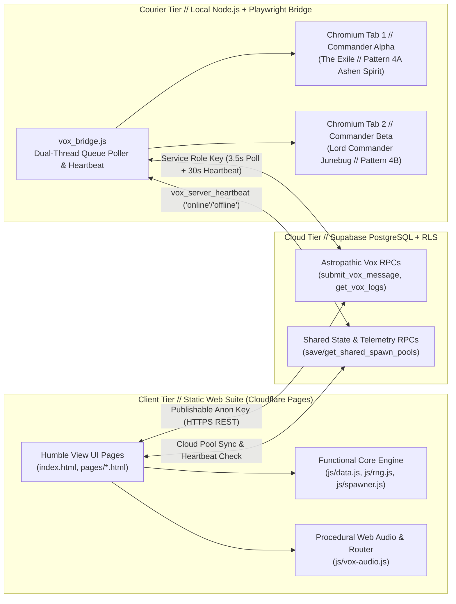

# Fires of Armageddon // Warhammer 40,000 Horde & Asymmetric Crusade Suite

A zero-dependency, offline-tolerant web companion suite, deterministic wave spawner, and real-time AI-bridged Astropathic Vox relay designed for cooperative, solo, and asymmetric Warhammer 40,000 Crusade campaigns.

---

## 🗺️ System Architecture

The project is engineered as a **three-tier hybrid architecture** combining a static client-side tactical suite (hosted on Cloudflare Pages), a serverless PostgreSQL/RPC state & message relay layer (Supabase), and a local dual-thread Playwright automation courier (`vox_bridge.js`) that bridges live Google Gemini web sessions into an in-universe Campaign Master.



---

## 🤖 AI Involvement & Human-AI Collaboration

This project integrates Artificial Intelligence across **two distinct layers**: as a **live runtime component** during tabletop campaign sessions, and as an **agentic pair-programming partner** during software engineering.

### 1. Runtime AI Involvement (Live Campaign Master & Asymmetric Narrative Engine)
During live campaign play, AI acts as the autonomous **Campaign Master**, **3rd Alliance ("The Marauders") Scavenger Commander**, and **Flagship Logic Core**:
- **Dual-Thread Google Gemini Automation (`vox_bridge.js`)**: Rather than calling stateless completion APIs, `vox_bridge.js` uses Playwright with a persistent Chromium profile (`./vox_chrome_profile`) to drive two long-running, context-rich Google Gemini notebook/chat threads—one isolated to **Commander Alpha (`THE EXILE // SANCTUARY OF ASH`)** and one isolated to **Commander Beta (`LORD COMMANDER JUNEBUG`)**.
- **Dynamic Prompt Routing & Pattern Injection**: When a player transmits a report from any page (`crusade.html`, `pvp.html`, `rogue.html`, `roster.html`, or `vox.html`), `vox_bridge.js` inspects the teletype header and wraps it in specialized system directives:
  - **Pattern 4A / 4B Ship Queries (`isShipQuery`)**: Routes `[TO: SHIP]` queries to either the *Pattern 4A Ashen Spirit cogitator readout* (`alpha` channel) or the *Pattern 4B Flagship Bridge Logic Core readout* (`beta` channel), preventing cross-flagship lore contamination.
  - **Pattern 5 Psychic Intercept Bleed**: Instructs the AI to append a `+++ [PASSIVE ASTROPATHIC CHOIR INTERCEPT] +++` block at the end of its response. `vox_bridge.js` programmatically splits this block out of the direct reply, scrubs citation artifacts, and injects it into the **rival commander's** `[ 👁️ INTERFERENCES ]` monitor (or broadcasts to **both** channels simultaneously for Mode 3 Rogue Sector clashes).
- **NotebookLM & Gemini Context Ingestion (`/bundles/`)**: The build script [`scripts/generate_bundles.js`](scripts/generate_bundles.js) compiles the entire repository into 12 domain-scoped Markdown bundles in [`/bundles/`](bundles/README.md) so the AI Campaign Master notebooks remain synchronized with live game rules, threat brackets, and Nemesis rosters.

### 2. Development-Time AI Involvement (Human-Directed Agentic Engineering)
- **Human Direction, Game Design & Architecture**: The tabletop game mechanics, asymmetric 3-Way Alliance Hegemony race, Tour of Duty progression, Warhammer 40k Crusade adaptations, UI/UX layout, and architectural constraints were designed and directed by the project creator.
- **Agentic Pair Programming (Google Antigravity)**: Code implementation, refactoring, procedural Web Audio synthesis, SVG sector cartography, Playwright DOM-stream stabilization, and the automated test suite were co-developed with **Google Antigravity** (utilizing Claude and Gemini coding models) under the strict engineering constitution codified in [`AGENTS.md`](AGENTS.md):
  - **100% Test-Driven Development (TDD)**: Every feature, bug fix, and UI boundary is backed by automated Node.js unit and headless Playwright browser tests (`171` passing tests across `tests/js/`, `tests/ui/`, and `tests/vox_bridge.test.js`) written via Red-Green-Refactor cycles.
  - **Continuous Bundle Synchronization**: Autonomous agents are strictly bound by `AGENTS.md` Principle IX to regenerate and verify `/bundles/*.md` on every file modification.

---

## 🏛️ Clean Code Architecture & "Dumb UI" (Humble View) Pattern

Per [`AGENTS.md`](AGENTS.md), the codebase enforces strict modularization and the **Functional Core, Imperative Shell** ("Dumb UI" / Humble View) pattern:

1. **Functional Core (Pure Domain Logic)**:
   - All game rules, Strategic Point calculations, PRNG algorithms, heartbeat staleness evaluators, and teletype dossier compilers (`compileRogueDossier`, `compilePvpVultureReport`, `compileNemesisDossier`, `isVoxServerOnline`, `mulberry32`, `resolveThreatBracket`, `executeRoundSpawns`) are written as pure, deterministic functions `(state, input) => output` with zero dependency on `document`, `window`, `localStorage`, or `fetch`.
2. **Declarative Rule Lookup Tables**:
   - Game outcomes (`ROGUE_OUTCOME_IMPACTS`), faction spawn brackets (`HORDE_FACTION_SPAWN_TABLES`), room-code prefixes (`ROOM_CODE_PREFIXES`), and environmental tables (`HELLSCAPES`, `ANOMALIES`) are modeled as declarative data maps rather than deeply nested `if / else` branching chains.
3. **Humble View ("Dumb UI") Imperative Shell**:
   - DOM interaction is isolated to thin input readers (`readRogueFormInputs`, `readPvpVultureFormInputs`, `readNemesisFormInputs`) and idempotent UI renderers (`renderServerStatusIndicator`, `updateRogueDossierPreview`, `renderFactionBracketTable`) that project explicit state onto the DOM and forward user events back to the pure core.

---

## 🔬 Technical Deep-Dive by Subsystem

### 1. Deterministic PRNG & Seeded Horde Spawner (`js/rng.js`, `js/spawner.js`, `js/data.js`)
- **Cross-Tabletop Seed Synchronization**: Co-op players enter a shared room seed (generated from 60 thematic Warhammer 40k prefixes such as `GOLGOTHA-4821` or `ASHEN-9012`). [`hashSeed()`](js/rng.js) hashes the string via a 32-bit avalanche mixer to seed [`mulberry32()`](js/rng.js), ensuring two separate tablets roll identical enemy spawns, misery cards, and resupply drops without requiring a live WebSocket connection during tabletop play.
- **Wave Escalation & Pity-Timer Math**: [`spawner.js`](js/spawner.js) computes per-round 2D6 modifiers based on Battle Round ($R_1 \dots R_5$), player count, and difficulty mode, resolving rolls against 5 threat brackets (`b34`, `b56`, `b79`, `b10`, `b13`) while dynamically scaling Resupply Pod drop probabilities via a cumulative pity counter.

### 2. Procedural Web Audio Synthesizer & Seamless Router (`js/vox-audio.js`)
- **Zero-Asset Web Audio API Synthesis**: Instead of loading external `.mp3` or `.wav` files, `VoxAudio` synthesizes all tactile UI feedback in real time using native `AudioContext` oscillator, gain, noise-buffer, and biquad-filter graphs:
  - Mechanical cogitator key-clanks (`playClank`), CRT teletype bursts, Warp anomaly sirens (`playWarpSurge`), orbital auspex pings (`playAuspexPing`), and a continuous sub-bass shipboard ambient drone.
- **Seamless SPA-Style Page Router**: To prevent the browser from destroying the active `AudioContext` ambient drone when navigating between `.html` pages, `vox-audio.js` intercepts internal navigation clicks, fetches the target HTML document in the background, swaps the `.shell` / `<main>` DOM tree, and safely re-evaluates page scripts in a clean lifecycle.

### 3. Supabase RPC Backend, Cloud Pool Sync & Live Server Telemetry
- **RLS & `SECURITY DEFINER` Isolation**: The browser client uses a publishable anon key restricted solely to vetted PostgreSQL RPC endpoints (`submit_vox_message`, `get_vox_logs`, `delete_vox_entry`, `save_shared_spawn_pools`, `get_shared_spawn_pools`). Direct table mutations require the `SUPABASE_SERVICE_KEY` held exclusively by the local `vox_bridge.js` courier.
- **Cross-Device Custom Shelf Barracks (`pages/roster.html`, `pages/spawner.html`)**: Players customize per-faction miniature pools in `roster.html` and sync them to Supabase via `save_shared_spawn_pools`. The Mode 1 Spawner automatically pulls and merges these custom pools into `HORDE_FACTION_SPAWN_TABLES`.
- **Live Courier Server Heartbeat (`vox_server_heartbeat`)**: `vox_bridge.js` publishes `{ status: 'online', updated_at }` to the shared state row on startup and every 30 seconds (and `{ status: 'offline' }` on `SIGINT`/`SIGTERM`). [`pages/vox.html`](pages/vox.html) polls this metadata and uses the pure [`isVoxServerOnline()`](pages/vox.html) evaluator (with a 90-second staleness window) to render a live green/red status badge on both the Security Clearance screen and the active CRT terminal header.

### 4. Astropathic Courier Playwright Engine (`vox_bridge.js`)
- **Concurrent Dual-Tab State Machine**: Manages two persistent Chromium pages in parallel locks (`isProcessing.alpha`, `isProcessing.beta`), draining pending Supabase queue items in FIFO order.
- **Streaming Stability & Artifact Scrubbing**: Polls the Gemini DOM response container until character length stabilizes across `STABLE_CHECKS_REQUIRED` consecutive intervals and all generating indicators disappear. [`scrubArtifacts()`](vox_bridge.js) and [`extractCleanLastModelResponse()`](vox_bridge.js) strip NotebookLM source citation chips, unwrap markdown code fences, sanitize nested HTML `<p>` tags inside `<li>` elements, and partition direct replies from cross-channel psychic intercepts.

---

## 🎮 Suite Modules (`index.html` & `pages/*.html`)

| Module | File | Core Technical Capabilities |
| :--- | :--- | :--- |
| **📖 Field Codex Launchpad** | [`index.html`](index.html) | Central command hub, onboarding protocol, and unified navigation bar. |
| **🧟 Mode 1: Horde Spawner** | [`pages/spawner.html`](pages/spawner.html) | Seed-synchronized wave generator, Misery Card deck manager, Pity-Timer resupply engine, and Cloud Pool integration. |
| **⚔️ Mode 2: 1v1 Ash Wastes PvP** | [`pages/pvp.html`](pages/pvp.html) | Dynamic Hellscape selector, Warp Intensity anomaly roller, Unbound Adversary spawner, and 3rd Alliance Vulture SPts Match Report compiler (`compilePvpVultureReport`). |
| **🎲 Mode 3: Rogue Sector & AI** | [`pages/rogue.html`](pages/rogue.html) | 3-Step autonomous AI behavioral state machine and declarative Rogue Sector Battle Report compiler (`ROGUE_OUTCOME_IMPACTS`, `compileRogueDossier`). |
| **🎖️ Mode 4: Hostile Matrix** | [`pages/roster.html`](pages/roster.html) | Cross-Mode Nemesis Bounty Ledger, Ordo Malleus Nemesis Induction compiler (`compileNemesisDossier`), Unbound Datasheets, and Supabase-synced Shelf Barracks. |
| **🏆 Mode 5: Crusade Command** | [`pages/crusade.html`](pages/crusade.html) | 3-Way Alliance Scoreboard, 4-Phase branching narrative trees, D6 upgrade rollers, Tour of Duty logistics tracker, Tomb World Awakening Matrix, Start of Tour Dispatch, and Master Post-Battle Dossier compiler. |
| **📜 Mode 6: Briefings & Atlas** | [`pages/briefing.html`](pages/briefing.html) | Passcode-sealed Commander Alpha/Beta dossiers, interactive `SHIP.md` orbital slider, 8-node interactive SVG Sector Atlas, and 3-Way Parallel Hegemony Race bars. |
| **📡 Mode 7: Astropath Vox** | [`pages/vox.html`](pages/vox.html) | Pass-Seal authenticated CRT terminal, elapsed-time teletype text streamer, Direct vs. Interferences monitors, `[ ✕ PURGE ]` RPC controls, and live Courier Server Status indicator. |
| **🎓 Quickstart Tutorials** | [`pages/welcome.html`](pages/welcome.html) | Field operations manual and guided walkthrough for all 7 suite modes. |

---

## 📂 Repository Structure

```text
armageddon-vox/
├── index.html                  # Root entry point (Field Codex & Command Launchpad)
├── AGENTS.md                   # Non-negotiable engineering & architectural directives
├── README.md                   # Technical architecture & project documentation
├── vox_bridge.js               # Dual-thread Playwright courier bridging Supabase <-> Gemini
├── vox_autopilot.bat           # Windows launcher with auto-dependency check
├── package.json                # Scripts & dev/runtime dependencies (Playwright, dotenv)
├── wrangler.jsonc              # Cloudflare Pages static deployment configuration
├── assets/                     # Vector icons & favicons (favicon.svg, favicon.png)
├── css/
│   └── style.css               # "Sanctuary-Noctis Hybrid" tactical stylesheet & CRT tokens
├── js/
│   ├── data.js                 # Faction tables, missions, misery cards, and lore constants
│   ├── rng.js                  # Deterministic hashSeed(), mulberry32() PRNG & 60 room prefixes
│   ├── spawner.js              # Pure wave-spawning math, bracket resolution & pity timer
│   ├── app.js                  # Mode 1 Horde Command UI controller & localStorage state
│   └── vox-audio.js            # Procedural Web Audio synth & seamless SPA page router
├── pages/                      # Modular suite views (spawner, pvp, rogue, roster, crusade, briefing, vox, welcome)
├── scripts/
│   └── generate_bundles.js     # Automated compiler for /bundles/*.md AI context artifacts
├── bundles/                    # 12 modular Markdown codebase bundles for Gemini / NotebookLM
└── tests/                      # 171 automated tests (Node:test + VM sandboxes + Playwright)
    ├── vox_bridge.test.js      # Courier prompt routing, scrubbing, queue & heartbeat tests
    ├── js/                     # Unit tests mirroring js/*.js
    └── ui/                     # Boundary, DOM, and headless browser E2E integration tests
```

---

## 🧪 Testing & Verification

The repository maintains a strict **100% test pass target** (`171` tests across unit, courier, and headless browser UI suites) using Node's native test runner (`node:test`), `node:vm` lexical sandboxes, and headless Playwright Chromium/Edge integration:

```bash
# Run the complete 171-test verification suite (unit + courier + headless browser E2E)
npm test

# Regenerate and synchronize all 12 modular Markdown bundles in /bundles/
npm run bundle

# Launch the local Astropathic Courier Gemini Bridge
npm run vox:bridge
# (or run vox_autopilot.bat on Windows)
```
